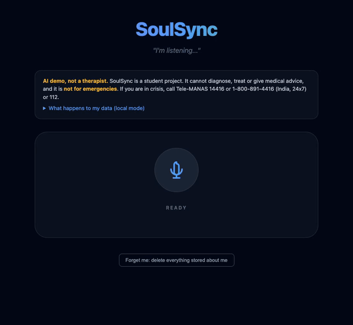
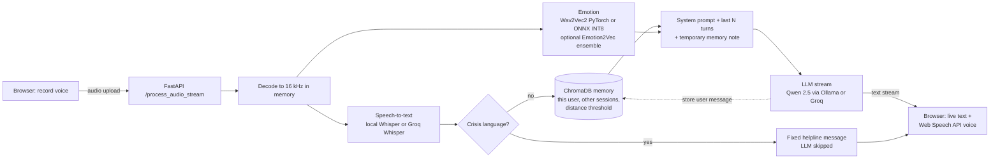

# SoulSync

SoulSync is a voice-first AI companion demo. You speak, it transcribes what you said, estimates the emotion in your voice, recalls relevant things you told it in earlier conversations, and streams a short supportive reply that your browser reads aloud. It runs fully on a laptop (Ollama, local Whisper, a fine-tuned Wav2Vec2 emotion model) or in a small cloud container (Groq APIs, an INT8 ONNX emotion model, no PyTorch). It is a student project and **not a therapist, not a medical device, and not for emergencies**.

<p align="center"></p>

<p align="center"><em>Recorded in local mode. The second reply recalls something said in an earlier session.</em></p>

## Architecture



## Features

- **Voice in, voice out.** Record in the browser; the reply streams as text and is spoken with the Web Speech API. The server does no text-to-speech by default.
- **Speech emotion recognition.** A Wav2Vec2 model fine-tuned on four acted-speech corpora with a speaker-independent split, exported to ONNX and quantised to INT8.
- **Long-term memory (RAG).** User messages are embedded with all-MiniLM-L6-v2 and stored in ChromaDB. Retrieval is filtered to the same user, excludes the current session, and drops anything beyond a tuned cosine-distance threshold.
- **Forget me.** One button deletes everything stored for that browser's user.
- **Safety layer.** Crisis and self-harm phrasing bypasses the LLM and returns a fixed message that suggests helplines. Questions about medication or diagnosis get a fixed "talk to your doctor" line appended. The app never places calls or contacts anyone.
- **Coping-skills knowledge base.** Ten short, reviewed general-wellbeing notes (breathing, grounding, sleep and similar) in a separate ChromaDB collection, offered as gentle suggestions and labelled as general information, not medical advice.
- **Rate limiting.** Each user can send a limited number of recordings per minute.
- **Two modes from one codebase**, selected by environment variables: local (nothing leaves the machine) and cloud (Groq for LLM and speech-to-text).
- **Reproducible evaluation.** Every number below is produced by a script and stored as JSON in `eval/results/`.

## Results

<!-- RESULTS:START -->
| What | Result | Source file |
|---|---|---|
| Emotion model, speaker-independent test (Wav2Vec2 alone) | 71.2% accuracy, 71.1% macro-F1 on 877 clips from 14 unseen speakers | `emotion_test.json` |
| v1 recipe reproduced, same test set | 32.4% accuracy, 28.8% macro-F1 | `emotion_baseline_v1_repro.json` |
| Unseen corpus (trained without TESS, tested on TESS) | 60.6% accuracy on 2000 clips | `emotion_cross_corpus_tess.json` |
| Ensemble with Emotion2Vec (Wav2Vec2 weight 0.4) | 89.5% accuracy, 89.5% macro-F1; see caveat | `emotion_ensemble.json` |
| ONNX INT8 vs PyTorch | 378.3 MB to 122.1 MB (67.7% smaller); CPU p50 70.2 ms to 65.5 ms; macro-F1 +0.4 points | `onnx_benchmark.json` |
| Memory retrieval, held-out half | Hit@3 81.0%, false recall 0.0%, 0 cross-user leaks | `memory_eval.json` |
| Local latency, upload to first reply token | p50 0.72 s, p95 1.41 s over 24 clips | `latency_local.json` |
| Cloud latency (Groq), upload to first reply token | p50 0.62 s, p95 0.78 s over 24 clips, measured from a laptop | `latency_cloud.json` |
| Cloud Docker image (no PyTorch) | 1502.4 MB; served 6/6 real requests under a 512 MB memory cap, not OOM-killed (peak 435.7 MiB without a cap) | `cloud_memory.json` |
| Tests | 123 pytest cases, no model downloads | `tests/` |

Caveats that matter: the emotion data is acted English speech; the v1 baseline is a reproduction of the old recipe, not the original weights; Emotion2Vec's training data probably overlaps the test corpora, so the ensemble figure is optimistic; the memory test set is small and synthetic.
<!-- RESULTS:END -->

Full tables, confidence intervals and caveats: [RESULTS.md](RESULTS.md). The complete training and evaluation record, with every epoch and every metric: [training/SoulSync_training_and_eval.ipynb](training/SoulSync_training_and_eval.ipynb).

## Setup

### Local mode (default)

Requirements: Python 3.11, [Ollama](https://ollama.com) with a Qwen 2.5 model, and about 8 GB of free disk.

```bash
git clone https://github.com/neerajprao/Ai_therapist && cd Ai_therapist
python3.11 -m venv .venv && source .venv/bin/activate
pip install -r requirements.txt
ollama pull qwen2.5:7b-instruct
cp .env.example .env            # defaults are fine for local mode
```

The emotion model weights are not in git. Download them from the Hugging Face Hub with `python scripts/hub.py download --repo npr1138/soulsync-emotion-wav2vec2` ([model page](https://huggingface.co/npr1138/soulsync-emotion-wav2vec2)), or train them yourself ([README_TRAINING.md](README_TRAINING.md)). Without them the app still runs and shows the emotion as "Unavailable".

Local mode also ensembles a second emotion model, Emotion2Vec (1.9 GB): `git lfs pull --include models/emotion2vec/model.pt` and `pip install funasr modelscope`. If it is missing the app logs an error and uses Wav2Vec2 alone; set `ENABLE_EMOTION2VEC=false` to switch it off.

```bash
uvicorn soulsync.api:app --port 5050
# open http://127.0.0.1:5050
```

### Cloud mode

Designed for a small container: no PyTorch, Groq for the LLM and speech-to-text, the INT8 ONNX emotion model, ChromaDB memory, browser speech output. The Docker build downloads the emotion model from the Hugging Face Hub (pinned revision, checksum verified), so hosts can build straight from this repository.

```bash
export GROQ_API_KEY=...  SECRET_KEY=$(python -c "import secrets; print(secrets.token_hex(32))")
docker compose up --build                      # http://localhost:8000
```

- LLM: `qwen/qwen3.8-27b`, the Qwen model Groq listed when this was written (a preview model). Set `LLM_MODEL=llama-3.1-8b-instant` for a production-tier alternative.
- Speech-to-text: `whisper-large-v3-turbo`.
- Rate limits depend on your Groq plan; see the limits page in your Groq account. When Groq returns HTTP 429 the app replies with a plain "please wait a minute" message.
- Cloud mode has been tested live against Groq from a laptop (see `eval/results/latency_cloud.json`).
- The image has been built and run under a 512 MB memory cap with real requests (see `eval/results/cloud_memory.json` and [RESULTS.md](RESULTS.md)). Re-measure with `python -m eval.cloud_memory`.
- **Memories may not persist on free hosts.** Many free tiers wipe the disk on restart, which erases the ChromaDB store. Mount a persistent volume, or point the memory layer at a hosted vector database; that option is documented here but not implemented.

### Configuration

All settings are environment variables; see [.env.example](.env.example). The main ones: `MODE`, `LLM_BACKEND`, `LLM_MODEL`, `STT_BACKEND`, `EMOTION_BACKEND`, `ENABLE_EMOTION2VEC`, `MEMORY_ENABLED`, `MEMORY_TOP_K`, `MEMORY_MAX_DISTANCE`, `HISTORY_MAX_TURNS`, `TTS_BACKEND`, `SECRET_KEY`, `GROQ_API_KEY`.

### Tests

```bash
pip install -r requirements-cloud.txt -r requirements-dev.txt
python -m pytest
```

The tests use fake models and need no downloads. GitHub Actions runs them on every push.

## Privacy and safety

| | Local mode | Cloud mode |
|---|---|---|
| Voice recording | Processed in memory on your machine, never saved | Sent to Groq for transcription; not saved by SoulSync |
| Transcript and recalled memories | Stay on your machine | Sent to Groq to generate the reply |
| Stored by SoulSync | Text of your past messages in a local ChromaDB folder | The same, on the server's disk |
| Identity | A random ID in a signed, HTTP-only cookie (1 year) | The same |
| Deletion | "Forget me" button, or delete the `data/` folder | "Forget me" button |

- Each user's memories are filtered by their ID on every read and delete. The evaluation checks for cross-user leaks.
- Messages that trigger the crisis layer are never written to long-term memory.
- The crisis layer is a keyword and regex list. It will miss indirect or coded language and it over-triggers on phrases like "I would never hurt myself". It is not a risk assessment.
- The helpline shown is India's Tele-MANAS (14416). Change `soulsync/safety.py` for other regions.
- Data sent to Groq is subject to Groq's own terms and retention policy.

## Limitations

- **Acted speech only.** The emotion model was trained and tested on actors reading scripted English sentences. Accuracy on spontaneous, real-world speech is unmeasured and is likely to be lower.
- **English only**, five emotion classes, and "anxious" is the corpora's "fearful" label.
- **Small test set.** 14 held-out speakers; confidence intervals cover clip sampling only.
- **Emotion2Vec's score is not a clean result.** It is a public pretrained model whose training data probably overlaps these corpora.
- **Memory evaluation is synthetic and small**, written by the project author.
- **The reply model often ignores recalled memories.** Retrieval works, but in the automated check Qwen 2.5 7B referenced a relevant earlier memory in only 1 of 4 cases.
- **No human evaluation of reply quality.** The automated LLM-as-judge scores are close to the ceiling and not informative. No clinical validation of any kind.
- **Single-process design.** Live chat history is held in memory, so it is lost on restart and does not scale across workers.

## Future work

- Evaluate on spontaneous speech (for example IEMOCAP or MSP-Podcast, licence permitting).
- Build and measure the cloud image; hosted vector database for persistent cloud memory.
- Human-rated reply quality, or a stronger, independent judge model.
- A larger, independently written memory test set.
- Get the reply model to use recalled memories more reliably (prompting or a larger model).

## Credits and licences

Datasets (not redistributed here): RAVDESS (CC BY-NC-SA 4.0), CREMA-D (ODbL 1.0), TESS (CC BY-NC 4.0), SAVEE (registration licence, no redistribution), via the Kaggle collection `uldisvalainis/audio-emotions`. See [docs/DATASET.md](docs/DATASET.md). Because two of these are non-commercial, the trained emotion model should be treated as non-commercial research output.

Models: `facebook/wav2vec2-base` (Apache-2.0), Whisper (MIT) via openai-whisper or faster-whisper, Qwen 2.5 via Ollama (check the licence of the specific tag), all-MiniLM-L6-v2 (Apache-2.0) via ChromaDB, Emotion2Vec via FunASR (see its model card for terms).

Source code: [MIT](LICENSE). Trained emotion-model weights: CC BY-NC-SA 4.0, because they are derived from non-commercial datasets. Datasets and third-party models keep their own licences.
