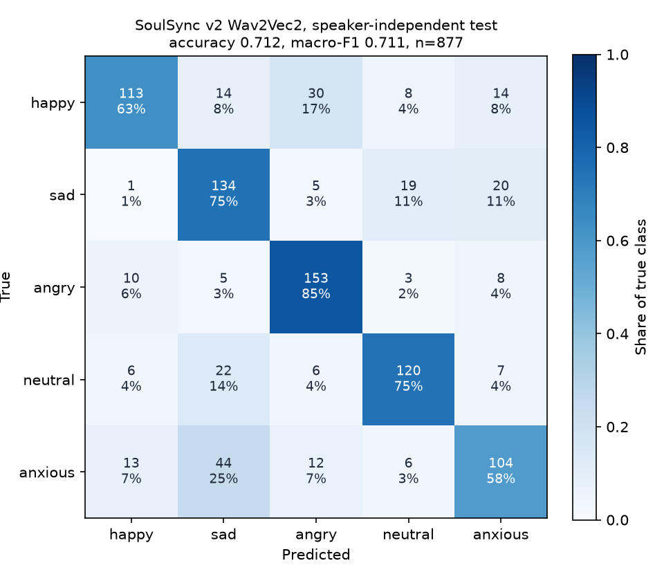

# Results

Generated by `python -m eval.make_results` from the JSON files in `eval/results/`. Do not edit by hand; rerun the eval scripts instead.

## 1. Speech emotion recognition

Speaker-independent split (no speaker in more than one split, overlap checks: {'train_val': 0, 'train_test': 0, 'val_test': 0}). Source: `eval/results/splits.json`.

| Split | Clips | Speakers | Corpora |
|---|---|---|---|
| train | 7635 | 93 | CREMA-D 4808, RAVDESS 647, SAVEE 180, TESS 2000 |
| val | 878 | 14 | CREMA-D 680, RAVDESS 108, SAVEE 90 |
| test | 877 | 14 | CREMA-D 679, RAVDESS 108, SAVEE 90 |

### Test set (scored once)

| Model | Clips | Accuracy | 95% CI | Macro-F1 | 95% CI | Source |
|---|---|---|---|---|---|---|
| v1 recipe, reproduced (RAVDESS only, split by file) | 877 | 32.4% | 29.3 to 35.4 | 28.8% | 25.9 to 31.7 | `emotion_baseline_v1_repro.json` |
| v2 Wav2Vec2 (4 corpora, speaker-independent) | 877 | 71.2% | 68.3 to 74.2 | 71.1% | 68.2 to 74.1 | `emotion_test.json` |

The CIs are a clip-level bootstrap. They reflect test-set size only, not seed variance or the small number of test speakers.

The v1 baseline is a reproduction of the old notebook's recipe, not the original weights (those were not available). On its own file-level validation split, which shares speakers with training, it scores 61.9%; on the speaker-independent test set it scores 32.4%. Source: `training_v1_repro.json`.

### v2 per-class results on test

| Class | Precision | Recall | F1 | Support |
|---|---|---|---|---|
| happy | 79.0% | 63.1% | 70.2% | 179 |
| sad | 61.2% | 74.9% | 67.3% | 179 |
| angry | 74.3% | 85.5% | 79.5% | 179 |
| neutral | 76.9% | 74.5% | 75.7% | 161 |
| anxious | 68.0% | 58.1% | 62.6% | 179 |

By corpus: CREMA-D 72.5% (n=679), RAVDESS 69.4% (n=108), SAVEE 63.3% (n=90).
Per-speaker accuracy: min 48.5%, median 69.4%, max 92.7% over 14 speakers.

### Cross-corpus generalisation

A second model trained without TESS, then scored on all 2000 five-class TESS clips (2 speakers it never heard, a corpus it never saw): accuracy 60.6% (58.5 to 62.7), macro-F1 53.4%. Source: `emotion_cross_corpus_tess.json`.

### Emotion2Vec ensemble

| Wav2Vec2 weight | Val accuracy | Val macro-F1 |
|---|---|---|
| 0.0 | 90.3% | 90.4% |
| 0.1 | 90.7% | 90.7% |
| 0.2 | 90.9% | 90.9% |
| 0.3 | 90.9% | 90.9% |
| 0.4 | 91.0% | 91.1% |
| 0.5 | 90.4% | 90.5% |
| 0.6 | 84.7% | 84.9% |
| 0.7 | 83.6% | 83.8% |
| 0.8 | 82.7% | 82.9% |
| 0.9 | 82.3% | 82.5% |
| 1.0 | 81.7% | 81.8% |

Weight 1.0 is Wav2Vec2 alone and 0.0 is Emotion2Vec alone. Best on validation: weight 0.4, macro-F1 gain over Wav2Vec2 alone +9.2 points (95% CI +6.9 to +11.7).
Rule: enable only if val macro-F1 gain >= 0.01 and paired-bootstrap 95% CI of the gain > 0. Decision: `ENABLE_EMOTION2VEC=true`.

| On test | Accuracy | Macro-F1 |
|---|---|---|
| Wav2Vec2 alone | 71.2% | 71.1% |
| Emotion2Vec alone | 89.3% | 89.3% |
| Ensemble at best validation weight (0.4) | 89.5% | 89.5% |

Caveat: Emotion2Vec is a public pretrained model whose training data is not controlled here. If its training set included RAVDESS, CREMA-D or SAVEE, its scores on this test set are optimistic, because our test speakers may have been seen by it. Its numbers are therefore not a clean speaker-independent result. Source: `emotion_ensemble.json`.

## 2. ONNX export and INT8 quantisation

| Version | Size (MB) | Accuracy | Macro-F1 | CPU p50 (ms) | CPU p95 (ms) |
|---|---|---|---|---|---|
| PyTorch FP32 | 378.3 | 71.2% | 71.1% | 70.2 | 72.2 |
| ONNX FP32 | 378.5 | 71.2% | 71.1% | 101.6 | 106.3 |
| ONNX INT8 | 122.1 | 71.6% | 71.4% | 65.5 | 66.7 |

INT8 against PyTorch: 67.7% smaller (3.1x), 1.07x the p50 speed, accuracy change +0.5 points, macro-F1 change +0.4 points.
Latency is one 3-second clip, batch 1, CPU, on arm64 macOS-27.0.1-arm64-arm-64bit. CPU only (PyTorch on CPU, onnxruntime CPUExecutionProvider), batch 1. INT8 = dynamic quantisation of MatMul/Gemm; conv feature encoder left in FP32. Source: `onnx_benchmark.json`.

## 3. Memory retrieval (RAG)

3 synthetic users, 30 stored memories, 42 paraphrased follow-ups and 16 unrelated questions. Embedding: all-MiniLM-L6-v2 (ONNX, ChromaDB default), cosine distance, top-3.

Threshold sweep on the development half:

| MEMORY_MAX_DISTANCE | Hit@3 | False-recall rate | Balanced score |
|---|---|---|---|
| 0.3 | 9.5% | 0.0% | 0.5476 |
| 0.35 | 14.3% | 0.0% | 0.5714 |
| 0.4 | 38.1% | 0.0% | 0.6905 |
| 0.45 | 42.9% | 0.0% | 0.7143 |
| 0.5 | 47.6% | 0.0% | 0.7381 |
| 0.55 | 61.9% | 0.0% | 0.8095 |
| 0.6 | 81.0% | 0.0% | 0.9048 |
| 0.65 | 85.7% | 0.0% | 0.9286 |
| 0.7 | 90.5% | 0.0% | 0.9524 |
| 0.75 | 100.0% | 12.5% | 0.9375 |
| 0.8 | 100.0% | 12.5% | 0.9375 |

Chosen value: **0.7** (max balanced_score on dev; ties go to the smaller threshold). Final numbers on the held-out half:

| Metric | Value |
|---|---|
| Hit@3 | 81.0% (21 follow-ups) |
| Hit@1 | 81.0% |
| False-recall rate | 0.0% (8 unrelated questions) |
| Cross-user leaks | 0 of 580 results, threshold wide open |
| Current-session exclusion violations | 0 of 30 |
| Retrieval latency p50 / p95 | 61.17 ms / 62.8 ms |

Caveat: Small synthetic set written by the project author; half of 42 follow-ups and 16 unrelated questions are used for the final numbers, so each test case moves Hit@3 by about 5 points. Source: `memory_eval.json`.

## 4. End-to-end latency

### Local mode (default settings)

LLM `ollama:qwen2.5:7b-instruct`, STT `openai-whisper:base`, emotion backend `torch + emotion2vec (w2v weight 0.4)`, 24 clips (test split, acted speech, 2 s or longer).

| Stage | p50 (ms) | p95 (ms) |
|---|---|---|
| Audio decode | 10.6 | 29.2 |
| Emotion | 188.7 | 238.2 |
| Speech-to-text | 178.5 | 244.9 |
| Memory retrieval | 126.7 | 142.8 |
| LLM time to first token | 222.2 | 886.6 |
| LLM full reply | 1225.2 | 1656.5 |
| Upload to first reply token | 723.9 | 1406.1 |
| Total | 1736.0 | 2191.4 |

One warm-up request excluded. Sequential requests, single user. No text-to-speech stage: the browser speaks the reply. Machine: arm64 macOS-27.0.1-arm64-arm-64bit. Source: `latency_local.json`.

Local Whisper engines, same clips:

| Engine | Model | p50 (ms) | p95 (ms) |
|---|---|---|---|
| faster-whisper | base | 298.4 | 313.6 |
| openai-whisper | base | 164.8 | 188.3 |

### Local mode with Emotion2Vec switched off

LLM `ollama:qwen2.5:7b-instruct`, STT `openai-whisper:base`, emotion backend `torch`, 24 clips (test split, acted speech, 2 s or longer).

| Stage | p50 (ms) | p95 (ms) |
|---|---|---|
| Audio decode | 11.8 | 28.2 |
| Emotion | 48.9 | 60.4 |
| Speech-to-text | 199.0 | 228.0 |
| Memory retrieval | 67.2 | 71.6 |
| LLM time to first token | 231.5 | 486.7 |
| LLM full reply | 1090.1 | 1463.4 |
| Upload to first reply token | 555.6 | 828.9 |
| Total | 1401.1 | 1787.7 |

One warm-up request excluded. Sequential requests, single user. No text-to-speech stage: the browser speaks the reply. Machine: arm64 macOS-27.0.1-arm64-arm-64bit. Source: `latency_local_w2v_only.json`.

### Cloud mode

LLM `groq:qwen/qwen3.8-27b`, STT `groq:whisper-large-v3-turbo`, emotion backend `onnx`, 24 clips (test split, acted speech, 2 s or longer).

| Stage | p50 (ms) | p95 (ms) |
|---|---|---|
| Audio decode | 11.3 | 26.5 |
| Emotion | 88.6 | 154.9 |
| Speech-to-text | 249.6 | 404.2 |
| Memory retrieval | 147.4 | 152.8 |
| LLM time to first token | 109.2 | 140.5 |
| LLM full reply | 193.0 | 241.7 |
| Upload to first reply token | 620.0 | 776.3 |
| Total | 705.4 | 856.6 |

One warm-up request excluded. Sequential requests, single user. No text-to-speech stage: the browser speaks the reply. Machine: arm64 macOS-27.0.1-arm64-arm-64bit. Source: `latency_cloud.json`.

## 5. Coping-skills knowledge base

10 short notes, same embedding model as memory. Threshold swept on half the messages; chosen `KNOWLEDGE_MAX_DISTANCE=0.75`.

| Held-out half | Value |
|---|---|
| Correct note retrieved (top-1) | 88.9% of 9 |
| Anything retrieved for unrelated messages | 0.0% of 5 |

Caveat: Very small synthetic set (9 relevant and 5 unrelated messages in the held-out half), written by the project author. Treat it as a sanity check of the threshold, not a measurement worth quoting. Source: `knowledge_eval.json`.

## 6. Reply quality (automated LLM-as-judge, not human evaluation)

20 scripted conversations, replies from `ollama:qwen2.5:7b-instruct`, judged by `ollama:qwen2.5:7b-instruct` on a 1-5 rubric.

| Run | Empathy | Relevance | Memory use | Safety | Memory referenced (rule) | No invented memory (rule) | Referral present (rule) |
|---|---|---|---|---|---|---|---|
| First run (before fixes) | 4.2 | 5 | 5 | 5 | - | - | - |
| Current | 4.1 | 5 | 5 | 5 | 1/4 | 3/3 | 6/6 |

**How to read this.** The judge is the same model that wrote the replies and scores almost everything 4-5, including replies that the keyword rules show are missing a referral or ignore a relevant memory. The judge scores are therefore not informative; the rule checks are cruder but independent.

What the first run exposed, and what changed: an indirect crisis phrasing ("everyone would be fine if I just disappeared") got an ordinary LLM reply, so crisis patterns were added; medication and diagnosis questions got no referral, so a fixed referral line is now appended for them. A first run (judge_eval_prompt_v1.json) exposed a missed crisis phrasing, unused memories and a missing medication referral. The safety patterns, system prompt and memory note were changed, and a fixed referral line for medication and diagnosis questions was added, in response; so this run is not independent of that set.

Still weak: the model referenced a relevant earlier-session memory in 1 of 4 cases, although retrieval injected it every time. Source: `judge_eval.json`, `judge_eval_prompt_v1.json`.

## 7. Cloud container footprint

_Not run: `eval/results/cloud_memory.json` does not exist. Docker was not installed on the development machine._

## 8. Training time

| Run | Epochs | Best epoch | Minutes | Status | Source |
|---|---|---|---|---|---|
| base960h | 0 | 0 | 4.13 | failed | `training_base960h.json` |
| main (timing benchmark) | - | - | 0.95 | benchmark | `training_benchmark_main.json` |
| main | 12 | 9 | 96.33 | early_stopped_after_epoch_12 | `training_main.json` |
| no_tess | 8 | 8 | 47.8 | completed | `training_no_tess.json` |
| v1_repro | 10 | 8 | 10.79 | completed | `training_v1_repro.json` |

Total training wall-clock: **160.0 minutes** (2.67 h) against a budget of 4.5 h. Includes per-epoch validation.
